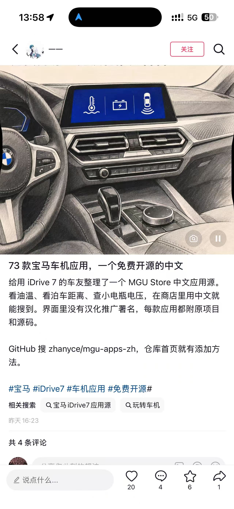
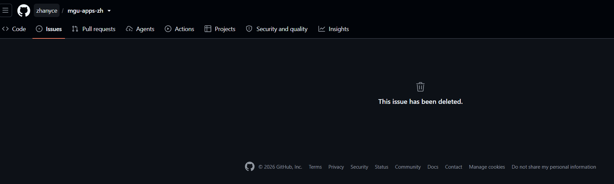

# MGU-CN-XIAOBAI

## 感谢上游作者与贡献者

感谢把代码、工具和文档开放出来的原作者，也感谢愿意审阅、测试、合并中文译文的维护者和车友。小白 MGU 中文源上的很多应用和组件，都是在这些项目的基础上做汉化、打包和维护的。

- MGU Store、部署和渲染组件，感谢 Robert Nisipeanu、IterioDev 及相关维护者。 [MGU Store](https://github.com/robertnisipeanu/mgu-store) · [iDrive Apps](https://github.com/robertnisipeanu/idrive-apps) · [渲染器上游署名](https://github.com/cauliflowermossgrape/idrive7-apps/blob/main/README.zh-CN.md)
- 车辆数据和仪表应用，感谢这些项目的作者与贡献者。 [cauliflowermossgrape/idrive7-apps](https://github.com/cauliflowermossgrape/idrive7-apps) · [alexp50/bmw-apps](https://github.com/alexp50/bmw-apps) · [bimmer-lab/apps](https://github.com/bimmer-lab/apps) · [ALMSTRA/idv7lol](https://github.com/ALMSTRA/idv7lol) · [pinguinooo/idrive7-apps](https://github.com/pinguinooo/idrive7-apps) · [beele/eldrive](https://github.com/beele/eldrive) · [benspa900/mon-vitals-idrive7](https://github.com/benspa900/mon-vitals-idrive7) · [RubenRios/GearHUD](https://github.com/RubenRios/GearHUD) · [TJM 与 SPRNV4 的仪表导航卡](https://github.com/tjmodsss/tjm-apps)
- 车辆设置、驾驶工具和车机小组件，感谢这些项目的作者与贡献者。 [arefahmad/idrive7-apps](https://github.com/arefahmad/idrive7-apps) · [NamelsMissing/mgu-apps](https://github.com/NamelsMissing/mgu-apps) · [giuseppesalatino-boop/mgu-apps](https://github.com/giuseppesalatino-boop/mgu-apps) · [DimonPrograms/dimonprograms-apps](https://github.com/DimonPrograms/dimonprograms-apps) · [suhailpatel/id7-apps](https://github.com/suhailpatel/id7-apps) · [dzooky/bmrmodz](https://github.com/dzooky/bmrmodz) · [hexlay/idrive7-custom-apps](https://github.com/hexlay/idrive7-custom-apps) · [hexlay/idrive7-system-monitor](https://github.com/hexlay/idrive7-system-monitor) · [JustAnotherPU/mgu-apps](https://github.com/JustAnotherPU/mgu-apps)
- 媒体、浏览器、天气和游戏，感谢这些项目的作者与贡献者。 [Vizualyse/idrive-apps](https://github.com/Vizualyse/idrive-apps) · [JustAnotherPU/ridetube](https://github.com/JustAnotherPU/ridetube) · [Leon Pllana 的 MGU Browser](https://github.com/pllanaio/mgu-browser) · [flash8523/bmw-weather-mgu](https://github.com/flash8523/bmw-weather-mgu) · [mistergahan/mgu-backgammon](https://github.com/mistergahan/mgu-backgammon)
- 也感谢字体、游戏引擎和素材的维护者。 [Noto Sans CJK](https://github.com/notofonts/noto-cjk) · [Barlow](https://github.com/jpt/barlow) · [doomgeneric](https://github.com/ozkl/doomgeneric) · [Freedoom](https://freedoom.github.io/)

原应用作者、源码、版本和汉化记录可从目录与发布记录核对。各项目及第三方组件继续适用各自的许可证，相关版权与许可声明以源码仓库和包内文件为准。 [应用目录](catalog.json) · [源码与汉化版本记录](provenance.json)


## 关于第三方重打包与汉化署名 · 2026-11-25

本源由小白科技杂物社（BiliBili 小白151 / GitHub JackieZ123430）维护。各应用的原作者及许可证以本源发布记录和对应上游项目为准。上游 `idrive7-apps` 的简体中文构建也明确保留了译者署名。 [上游署名记录](https://github.com/cauliflowermossgrape/idrive7-apps/commit/8cccfde3d01aa73f64e78fde7d1b0c6741fc56b5)

`zhanyce/mgu-apps-zh` 的公开清单收录了 73 款应用，其中 71 款以本源发布的汉化包为输入，输入包的 SHA-256 与本源目录逐项一致。对方的构建脚本会移除应用界面和代码中的翻译署名。已解包核验的 ADAS 功能状态 `0.1.3` 仍保留本源 `0.1.2` 的下载地址、校验值、MIT 许可证和汉化版权声明。 [对方的输入包清单](https://github.com/zhanyce/mgu-apps-zh/blob/66a28bdd4a5ee3f0b475d36a1642e7ba6114c5d5/data/apps.json) · [删除署名的脚本](https://github.com/zhanyce/mgu-apps-zh/blob/66a28bdd4a5ee3f0b475d36a1642e7ba6114c5d5/tools/build.py#L118-L132) · [本源的原始发布](https://github.com/JackieZ123430/MGU-CN-XIAOBAI/releases/tag/zh-translation-credit-2026-11-23)

对方在抖音宣传中明确指向这个仓库，并写到「界面里没有汉化推广署名」。此前请求恢复署名的 Issue #1 已被删除。随后尝试附图重新提交，GitHub API 返回 `403 Blocked`。请再分发者明确标注原应用作者、译者和重打包维护者，并在受影响的安装包与商店条目中恢复译者署名。 [抖音宣传截图](docs/evidence/2026-11-25/douyin-post.jpg) · [Issue #1 删除状态截图](docs/evidence/2026-11-25/issue-1-deleted.png) · [对方仓库的讨论](https://github.com/zhanyce/mgu-apps-zh/issues)


<details>
<summary>查看抖音宣传和原 Issue 删除截图</summary>





</details>


## idv7lol 自定义仪表简中版 · iDrive 7

- idv7lol 自定义仪表 `0.2.1901` · 在 iDrive 7 预览并选择自定义仪表主题、配色和单位，支持导入 U 盘主题。默认关闭仪表覆盖。 · https://github.com/ALMSTRA/idv7lol

[发布页及校验信息](https://github.com/JackieZ123430/MGU-CN-XIAOBAI/releases/tag/idv7lol-zh-cn-2026-11-23)


## iDrive 7 · 11 款应用统一为故障检测的翻译署名

- ADAS 功能状态 `0.1.2` · 查看碰撞声音警告、起步横向车流防护与狭窄通行辅助的实时可用性及 ECU 状态。 · https://github.com/alexp50/bmw-apps
- 车机接口浏览器 `0.2.402` · 在车机接口目录中查找氛围灯、导航、GPS、媒体、空调和车门等服务。可导出接口报告，仅本地读取。 · https://github.com/arefahmad/idrive7-apps
- 轮胎与胎压设置 `0.2.102` · 查看胎压、目标值、轮胎识别状态与车辆轮胎列表。支持 iDrive 轮胎设置操作，保留上游的驻车确认与 DSC 检查。 允许更改车辆设置仍按上游默认关闭。 · https://github.com/arefahmad/idrive7-apps
- 12 V 电池与电气 `1.0.2` · 监测 12 V 电池的电压、电流、电量、健康度和温度，提供状态评估。 · https://github.com/DimonPrograms/dimonprograms-apps
- 赛道计圈 `1.0.2` · 赛道计圈，支持分段、最佳圈和实时差值。 用于封闭赛道。 · https://github.com/DimonPrograms/dimonprograms-apps
- Mon Vitals 行车仪表 `0.9.602` · iDrive 7 只读仪表，显示温度、增压、动力、底盘等数据。 · https://github.com/benspa900/mon-vitals-idrive7
- F44 标志与信号灯诊断 `0.1.2` · 在本机目录中查找交通标志及信号灯接口，仅供诊断。 · https://github.com/benspa900/mon-vitals-idrive7
- elDrive 电动续航与充电 `1.1.2` · 电动车能耗与充电仪表，支持纯电车型（如 iX3），显示续航、动力电池、空调功耗、充电记录及 12 V 电压。 · https://github.com/beele/eldrive
- 挡位 HUD `1.0.2` · 在 HUD 和仪表显示当前挡位，可分别设置常规、S 挡和 M 挡的颜色。 · https://github.com/RubenRios/GearHUD
- TJM 导航提示卡 `0.9.202` · 在兼容的仪表地图上显示下一转向、距离、道路与车道。可读取手机或宝马导航指引、外部文件，也可播放演示。 仪表地图叠加还需上游的 Waze on cluster 服务。 · https://github.com/tjmodsss/tjm-apps
- 西洋双陆棋 `0.1.102` · 支持短局和长局规则，本地双人或人机对弈。 · https://github.com/mistergahan/mgu-backgammon

[发布页及校验信息](https://github.com/JackieZ123430/MGU-CN-XIAOBAI/releases/tag/zh-translation-credit-2026-11-23)


## iDrive 7 简中源 100 项 · 新增 11 款应用

- ADAS 功能状态 `0.1.1` · 查看碰撞声音警告、起步横向车流防护与狭窄通行辅助的实时可用性及 ECU 状态。 · https://github.com/alexp50/bmw-apps
- 车机接口浏览器 `0.2.401` · 在车机接口目录中查找氛围灯、导航、GPS、媒体、空调和车门等服务。可导出接口报告，仅本地读取。 · https://github.com/arefahmad/idrive7-apps
- 轮胎与胎压设置 `0.2.101` · 查看胎压、目标值、轮胎识别状态与车辆轮胎列表。支持 iDrive 轮胎设置操作，保留上游的驻车确认与 DSC 检查。 允许更改车辆设置仍按上游默认关闭。 · https://github.com/arefahmad/idrive7-apps
- 12 V 电池与电气 `1.0.1` · 监测 12 V 电池的电压、电流、电量、健康度和温度，提供状态评估。 · https://github.com/DimonPrograms/dimonprograms-apps
- 赛道计圈 `1.0.1` · 赛道计圈，支持分段、最佳圈和实时差值。 用于封闭赛道。 · https://github.com/DimonPrograms/dimonprograms-apps
- Mon Vitals 行车仪表 `0.9.601` · iDrive 7 只读仪表，显示温度、增压、动力、底盘等数据。 · https://github.com/benspa900/mon-vitals-idrive7
- F44 标志与信号灯诊断 `0.1.1` · 在本机目录中查找交通标志及信号灯接口，仅供诊断。 · https://github.com/benspa900/mon-vitals-idrive7
- elDrive 电动续航与充电 `1.1.1` · 电动车能耗与充电仪表，支持纯电车型（如 iX3），显示续航、动力电池、空调功耗、充电记录及 12 V 电压。 · https://github.com/beele/eldrive
- 挡位 HUD `1.0.1` · 在 HUD 和仪表显示当前挡位，可分别设置常规、S 挡和 M 挡的颜色。 · https://github.com/RubenRios/GearHUD
- TJM 导航提示卡 `0.9.201` · 在兼容的仪表地图上显示下一转向、距离、道路与车道。可读取手机或宝马导航指引、外部文件，也可播放演示。 仪表地图叠加还需上游的 Waze on cluster 服务。 · https://github.com/tjmodsss/tjm-apps
- 西洋双陆棋 `0.1.101` · 支持短局和长局规则，本地双人或人机对弈。 · https://github.com/mistergahan/mgu-backgammon

[发布页及校验信息](https://github.com/JackieZ123430/MGU-CN-XIAOBAI/releases/tag/zh-catalog-100-2026-11-23)


## pinguinooo ID7 套件简中版 · 2026-11-23

- 换挡提示灯 `0.4.501` · 在仪表和 HUD 显示换挡灯，支持驾驶模式阈值和冷机限制。 · https://github.com/pinguinooo/idrive7-apps
- 发动机仪表 `0.2.1` · 查看发动机和变速箱温度、增压、动力、挡位，含暖机和涡轮冷却提示。 · https://github.com/pinguinooo/idrive7-apps
- M Track 仪表 Beta `0.1.701` · M Track 风格仪表覆盖，默认关闭。仅兼容支持仪表面板渲染的配置，车机实测待验证。 · https://github.com/pinguinooo/idrive7-apps

[发布页及校验信息](https://github.com/JackieZ123430/MGU-CN-XIAOBAI/releases/tag/pinguinooo-suite-zh-2026-11-23)


## 简中缺字修复 · 2026-11-23

- 故障检测 `2.9.802` · 读取和清除各控制单元的故障存储，并查看当前检查控制信息。 · https://github.com/JackieZ123430/MGU-CN-XIAOBAI/releases/download/source-refresh-2026-11-20/dtc_scanner%402.9.801.tgz
- 氛围灯工作室 `0.1.502` · 全屏设置驾驶模式配色和氛围灯提醒 · https://github.com/JackieZ123430/MGU-CN-XIAOBAI/releases/download/source-refresh-2026-11-20/ambient_studio_full%400.1.501.tgz
- 颗粒捕集器监测 `0.4.2` · 只读监测柴油颗粒捕集器积碳、再生进度、温度、压差及历史记录 · https://github.com/JackieZ123430/MGU-CN-XIAOBAI/releases/download/source-refresh-2026-11-20/dpf_monitor%400.4.1.tgz
- 抬头显示助手 `0.1.602` · 全屏设置 HUD 转向箭头、运动挡位和转速、换挡提示及发动机暖机信息 · https://github.com/JackieZ123430/MGU-CN-XIAOBAI/releases/download/source-refresh-2026-11-20/drive_hud_full%400.1.601.tgz
- 仪表夜视 `0.2.102` · 全屏控制宝马夜视和泊车摄像头在仪表中的显示 · https://github.com/JackieZ123430/MGU-CN-XIAOBAI/releases/download/source-refresh-2026-11-20/front_camera_cluster%400.2.101.tgz
- 绿灯起步提醒 `0.2.502` · 监测 KAFAS 原始红绿灯信号，并以宝马已验证的显示信号作为后备 · https://github.com/JackieZ123430/MGU-CN-XIAOBAI/releases/download/source-refresh-2026-11-20/green_light_alert%400.2.501.tgz
- 热点工作室 `0.1.502` · 通过宝马热点提供华为网络代理，并按需开启单客户端限时 ENET 转发 · https://github.com/JackieZ123430/MGU-CN-XIAOBAI/releases/download/source-refresh-2026-11-20/hotspot_studio%400.1.501.tgz
- 泊车距离 `0.1.802` · 只读显示 PDC 距离、转向轨迹和悬架姿态 · https://github.com/JackieZ123430/MGU-CN-XIAOBAI/releases/download/source-refresh-2026-11-20/parking_clearance%400.1.801.tgz
- 后排舒适控制 `0.5.602` · G12 行政座舱后排空调、舒适座椅、按摩、遮阳帘及娱乐控制 · https://github.com/JackieZ123430/MGU-CN-XIAOBAI/releases/download/source-refresh-2026-11-20/rear_comfort%400.5.601.tgz
- 车身高度工作室 `0.6.2` · 全屏设置 VDP 预设及前后空气弹簧充放气 · https://github.com/JackieZ123430/MGU-CN-XIAOBAI/releases/download/source-refresh-2026-11-20/ride_height%400.6.1.tgz
- 行程电脑 `1.0.3` · 全屏显示行程历史、油耗、油价、费用、续航、车外温度和 GPS 海拔 · https://github.com/JackieZ123430/MGU-CN-XIAOBAI/releases/download/widget-chinese-r2-2026-11-20/road_trip_computer%401.0.2.tgz
- 自动启停状态 `0.1.302` · 显示当前及最近十条自动启停抑制状态，以及实时用电负载 · https://github.com/JackieZ123430/MGU-CN-XIAOBAI/releases/download/source-refresh-2026-11-20/start_stop_insight%400.1.301.tgz
- 车辆遥测 `0.2.2` · 分类全屏显示动力、热管理、底盘、轮胎、空调和电气实时数据 · https://github.com/JackieZ123430/MGU-CN-XIAOBAI/releases/download/source-refresh-2026-11-20/telemetry_studio%400.2.1.tgz
- 车辆健康中心 `0.1.902` · 只读查看轮胎、油液、温度、保养需求、检查控制、DPF 和当前故障 · https://github.com/JackieZ123430/MGU-CN-XIAOBAI/releases/download/source-refresh-2026-11-20/vehicle_health%400.1.901.tgz
- 车辆网络 `0.1.302` · 显示 MGU 网络接口、观测到的车辆网络设备和电脑 IPv4 设置 · https://github.com/JackieZ123430/MGU-CN-XIAOBAI/releases/download/source-refresh-2026-11-20/vehicle_network%400.1.301.tgz
- xDrive 动力分配 `0.1.502` · 只读查看 xDrive 扭矩分配、分动箱扭矩、车轮滑差和底盘动态 · https://github.com/JackieZ123430/MGU-CN-XIAOBAI/releases/download/source-refresh-2026-11-20/xdrive_studio%400.1.501.tgz
- RideTube `0.4.502` · ID7 非官方 YouTube 客户端，支持搜索、频道、章节及登录后的首页、订阅和稍后观看。通过车机播放声音，默认停车时显示画面。需要 jap-ridetube-d 服务。 · https://github.com/JackieZ123430/MGU-CN-XIAOBAI/releases/download/source-refresh-2026-11-20/jap_ridetube%400.4.501.tgz
- 车机浏览器 `0.16.102` · 车机浏览器，支持首页、历史记录、书签和 iDrive 操作。 · https://github.com/JackieZ123430/MGU-CN-XIAOBAI/releases/download/source-refresh-2026-11-20/mgu_browser%400.16.101.tgz
- 加油记录 `0.1.4502` · Spritmonitor 第三方客户端，记录加油和 AdBlue。默认简中，可在应用内切换语言；同步需要联网和 Spritmonitor 账户。 · https://github.com/JackieZ123430/MGU-CN-XIAOBAI/releases/download/five-cn-apps-2026-11-23/spritmonitor%400.1.4501.tgz

[发布页及校验信息](https://github.com/JackieZ123430/MGU-CN-XIAOBAI/releases/tag/zh-font-coverage-2026-11-23)


## 五款 ID7 应用简中版 · 2026-11-23

- 胎压监测 `0.1.501` · 四轮实时胎压和胎温、车辆目标值及冷胎趋势。G08 上游标明仍需实车验证。 · https://github.com/suhailpatel/id7-apps
- HUD 小组件 `0.15.801` · 在 HUD 显示挡位、温度、换挡灯或行程数据，支持多布局。需要原车 HUD 和兼容的 cluster-render。 · https://github.com/bimmer-lab/apps
- 仪表歌词 `0.1.401` · 连接自有 Spotify 账户，从 LRCLIB 获取同步歌词，可在停车时显示到兼容仪表地图窗口。此次汉化针对应用界面，歌词字库沿用上游。 · https://github.com/NamelsMissing/mgu-apps
- G21 加热舒适 Beta `0.5.401` · G21 方向盘和座椅加热的入口、诊断页面与日志。自动加热默认关闭。不同控制单元的兼容性依车辆配置而定。 · https://github.com/NamelsMissing/mgu-apps
- 加油记录 `0.1.4501` · Spritmonitor 第三方客户端，记录加油和 AdBlue。默认简中，可在应用内切换语言；同步需要联网和 Spritmonitor 账户。 · https://github.com/dzooky/bmrmodz

[发布页及校验信息](https://github.com/JackieZ123430/MGU-CN-XIAOBAI/releases/tag/five-cn-apps-2026-11-23)


## 上游评审修订与简中应用更新 · 2026-11-23

- Spotify Beta `1.0.3401` · Spotify Connect 简中版。支持常用简繁体曲名、歌单及设备名，播放需要手机配对、车机联网与 Spotify 账号。 · https://github.com/hexlay/idrive7-custom-apps
- M-Copilot 车辆助手 `1.0.3701` · 查看车辆数据、故障与保养，并可连接手机配置 AI。车机联网功能需要自备服务账号。 · https://github.com/hexlay/idrive7-custom-apps
- 限速提示（格鲁吉亚） `1.0.1001` · 按车机位置显示离线限速，内置数据为格鲁吉亚。仪表及 HUD 输出依赖兼容的渲染组件。 · https://github.com/hexlay/idrive7-custom-apps
- 系统监控 `1.0.805` · 只读查看车机 CPU、温度、进程和内存。修复进程名被误翻译、失效入口重试等问题。 · https://github.com/hexlay/idrive7-system-monitor
- 车机资源监控 `1.0.604` · 查看 CPU、可用内存、应用内存额度、Swap 和图形频率。此版本同步维护者审阅后的修订。 · https://github.com/JustAnotherPU/mgu-apps

[发布页及校验信息](https://github.com/JackieZ123430/MGU-CN-XIAOBAI/releases/tag/hexlay-review-2026-11-23)


## 音乐应用 Beta（2026-11-22）

| 应用 | 版本 | 后台方式 |
| --- | --- | --- |
| 网易云音乐 Beta | 0.5.5 | 车机内置后台，需要 Node.js 22 与网络 |
| 汽水音乐 Beta | 0.2.6 | 车机内置后台，需要 Node.js 22 与网络 |
| QQ 音乐社区版 Beta | 0.1.1 | 外置后台实验版，车机包不能单独工作 |
| 酷狗音乐 Beta | 0.1.1 | 外置后台实验版，车机包不能单独工作 |
| Spotify Beta | 原有版本保留 | 原有 Spotify Connect 逻辑 |

本次整理 Beta 上架信息，不代表接口长期有效或重新完成全部播放实测。QQ/酷狗需要另行配置外置后台；网易云与汽水的后台随应用运行。所有应用均受账号歌曲权限、网络及上游接口限制。完整说明以本次发布页及商店条目为准。

当前使用 GitHub 主源，未配置新的国内镜像，也没有自动同步至 Gitee。

PowerBy 小白科技杂物社 · FREE APPS IF PAID PLEASE RETURN · 免费应用请勿付费。
禁止私自分发，所有更新必须来自我的源。各上游组件沿用原作者许可。


BMW MGU / iDrive 应用中文软件源。汉化与维护：小白科技杂物社 · BiliBili 小白151 · GitHub JackieZ123430。

FREE APPS IF PAID PLEASE RETURN · 免费应用请勿付费。

## 添加软件源

在 MGU Store 中添加以下根目录 catalog.json：

```
https://raw.githubusercontent.com/JackieZ123430/MGU-CN-XIAOBAI/refs/heads/main/catalog.json
```

安装包通过 GitHub Releases 公开下载，车机无需登录 GitHub。既有相对路径安装包仍保留，便于回退。

## 2026-11-20 更新

本次逐项检查原目录的 69 项应用和组件，更新落后版本、补齐中文说明与新版界面文字，并增加 5 个首页组件。目录现有 74 项，62 项版本更新或新增。已是当前版本的组件保留原版本。

中文构建保留上游英文 app.json、应用标识、信号接口和设置值。中文修订的三段版本为 `major.minor.(上游 patch × 100 + 中文修订号)`，例如上游 `0.3.1` 对应中文修订 `0.3.101`。真实上游版本、对应公开源码和提交记录见 [provenance.json](provenance.json) 与包内 SOURCE.zh-CN.json。后续中文修订必须增加版本，不替换已发布版本的安装包。

| 新增首页组件 | 作用 |
| --- | --- |
| aref_carcare | 车辆养护：独立保养周期与首页组件 |
| aref_carwatch | 车辆监控：行程、故障和失火事件 |
| aref_carlyrics | 车载歌词：读取当前曲目并联网获取歌词 |
| aref_eta | 导航到达时间：Apple Maps 到达时间及首页组件 |
| gif_home | GIF 首页组件：动画、上传和显示设置 |

ETA 的仪表显示需要 cluster-render，并可能与其他仪表显示应用竞争；首页组件与仪表显示分别验证。台架上先保留现有投射设置。

汽水音乐 **0.2.5 Beta** 补齐 `mguInternet: true`，让安装器自动登记联网名单。安装依赖 mgu-uplink 只提供联网组件，应用自己的声明才触发出网登记。系统日期、Wi-Fi 路由和账号音频权限仍分别影响网络和播放结果。此版保持 0.2.4 的界面、播放代码和应用数据结构。

本机构建、语言隔离、字体字形、依赖闭合和安装包校验已经通过。实机安装、HMI 画面、车辆信号及实际声音属于不同验证项，当前状态以 [VALIDATION-20261120.md](VALIDATION-20261120.md) 为准。

## 源码与上游汉化 PR

保留原项目许可证与作者声明。中文署名只显示于中文构建。公开通用 Kit 安装包不包含提取的 BMW oap-sdk，由车机部署流程提供本机 SDK。

- [arefahmad/idrive7-apps](https://github.com/arefahmad/idrive7-apps/pull/2)：当前中文修订已提交，是否合并以上游状态为准。
- [NamelsMissing/mgu-apps](https://github.com/NamelsMissing/mgu-apps/pull/9)：当前中文修订已提交，是否合并以上游状态为准。
- [cauliflowermossgrape/idrive7-apps](https://github.com/cauliflowermossgrape/idrive7-apps/pull/217)：当前中文修订已提交，是否合并以上游状态为准。
- [bimmer-lab/apps](https://github.com/bimmer-lab/apps/pull/30)：当前中文修订已提交，是否合并以上游状态为准。
- [hexlay/idrive7-custom-apps](https://github.com/hexlay/idrive7-custom-apps/pull/4)：当前中文修订已提交，是否合并以上游状态为准。
- [JustAnotherPU/ridetube](https://github.com/JustAnotherPU/ridetube/pull/16)：当前中文修订已提交，是否合并以上游状态为准。
- [giuseppesalatino-boop/mgu-apps](https://github.com/giuseppesalatino-boop/mgu-apps/pull/2)：当前中文修订已提交，是否合并以上游状态为准。
- [alexp50/bmw-apps](https://github.com/alexp50/bmw-apps/pull/4)：当前中文修订已提交，是否合并以上游状态为准。
- [pllanaio/mgu-browser](https://github.com/pllanaio/mgu-browser/pull/13)：当前中文修订已提交，是否合并以上游状态为准。

各中文源码仓库也提供根目录 catalog.json；安装包引用本仓库的 GitHub Release，避免在多个来源重复维护不同字节的同版本包。联系条目只展示信息，不能下载安装。

## 首页组件中文显示修订 2

本轮进一步修复了 8 款带组件应用的中文传输与资源打包。缩小组件通过自己的 UTF-8 字符串资源显示中文；大组件固定标签翻译为中文，歌曲、歌手和歌词按原文显示。新增 [Aref #3](https://github.com/arefahmad/idrive7-apps/pull/3) 跟进显示修复；此前 Aref #2 已被上游合并。

## 两款系统监控中文版

系统监控 1.0.804、车机资源监控 1.0.603 已加入本源。P18 台架已验证原生前台焦点与实际应用身份采样。https://github.com/JackieZ123430/MGU-CN-XIAOBAI/releases/tag/system-monitors-cn-20261120

https://github.com/hexlay/idrive7-system-monitor/pull/1
https://github.com/JustAnotherPU/mgu-apps/pull/7
